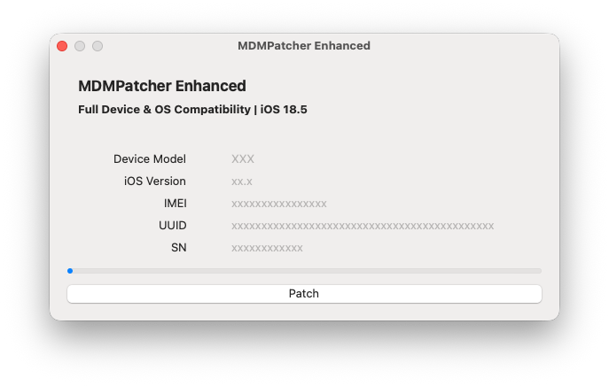
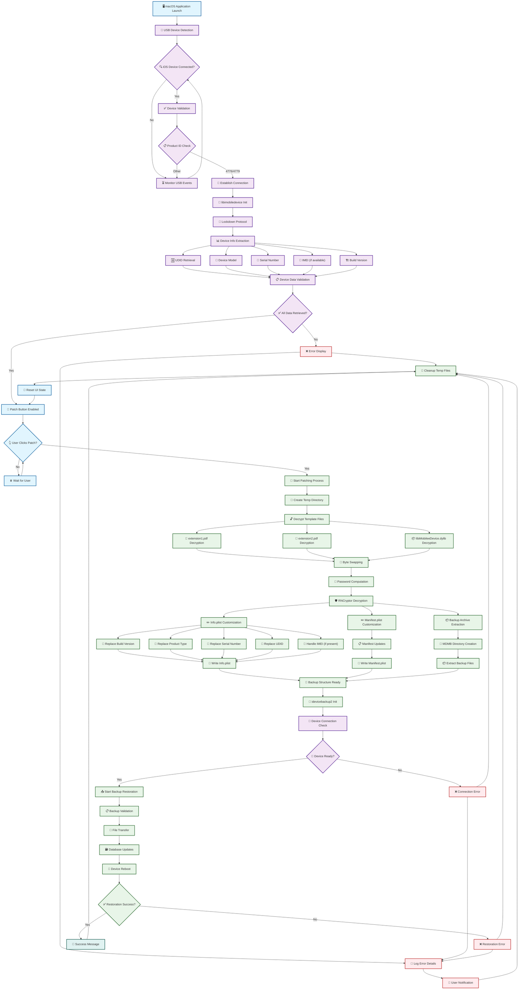

# MDMPatcher Enhanced

> **iOS / iPadOS 27: this tool does not work.** Apple changed how management information is restored from backups, closing the route used by this app. See [Compatibility](#compatibility) for Apple's documentation and the limits of downgrading.
>
> **Maintenance:** I don't actively maintain this repository. Contributions, documentation fixes, compatibility reports, and pull requests are welcome. See [Maintenance & Contributions](#maintenance--contributions).

### ⚠️ **Legal & Technical Disclaimer**  
> This project is intended strictly for **educational, diagnostic, and personal device recovery use only**.  
> It must **only** be used on iOS devices that the user **legally owns** and has the right to modify.  
>
> **MDMPatcher Enhanced does not jailbreak, exploit or modify firmware**. It relies entirely on public interfaces (AFC, plist editing, USB restore flows).  
>
> The tool targets situations like second-hand iOS devices where MDM was not removed correctly.  
> **Using this software on managed, corporate, or institutional devices without permission is prohibited and may be illegal.**

## Table of Contents

- [Overview](#overview)
- [Compatibility](#compatibility)
- [Maintenance & Contributions](#maintenance--contributions)
- [Requirements](#requirements)
- [Instructions](#instructions)
- [Troubleshooting](#typical-issues)
- [Internals](#internals--architecture)

## Overview

MDMPatcher Enhanced is a macOS tool that helps remove or bypass Mobile Device Management (MDM) profiles from supervised iPhones and iPads. It is designed for scenarios where users need to regain full control over a personally owned device — for example after second-hand purchases or faulty deregistration.

No jailbreak is required. No low-level kernel or firmware modifications are performed.

### Application Preview

## Compatibility

**MDMPatcher Enhanced does not work on iOS 27 or iPadOS 27.** Apple's [WWDC26 device management updates](https://support.apple.com/guide/deployment/depd638aa061/web) explain that these versions no longer restore management information from backups. Devices registered with Apple School Manager or Apple Business enroll again through Automated Device Enrollment after restoration. Apple also documents this behavior in [Restore managed Apple devices](https://support.apple.com/guide/deployment/restore-managed-apple-devices-depd44f04xc4/web).

This app uses a modified backup and restore workflow, so that change closes the route it relies on. This is the project's compatibility assessment based on Apple's documented change; Apple does not name MDMPatcher Enhanced in those notes.

Earlier versions may still work, depending on the device and firmware. For example, [issue #12](https://github.com/fled-dev/MDMPatcher-Enhanced/issues/12) reports success on an iPhone 15 with iOS 26.2. That is a community report, not a guarantee for every iOS 26 release or device.

### Downgrading from iOS / iPadOS 27

You may still be able to use the tool after first downgrading to compatible older firmware **if Apple is still signing that firmware for your exact device**. Use [IPSW Downloads](https://ipsw.me) to find a matching pre-27 IPSW and check its signing status, then use Finder's **Option + Restore** to select that IPSW, as described in [Instructions](#instructions).

Apple's [Secure software updates](https://support.apple.com/guide/security/secure-software-updates-secf683e0b36/web) explains that installation requires Apple's current authorization. Downloading an unsigned IPSW does not make it installable through Finder. If no compatible pre-27 firmware is signed for your device, this downgrade route is unavailable. Devices that shipped with iOS / iPadOS 27 may have no compatible older firmware at all.

**Restoring erases the device.** Back up your data first; a backup made on a newer OS may require that newer OS to restore ([Apple's backup compatibility guidance](https://support.apple.com/en-us/108811)). Downgrading or using this tool does not release a device from an organization's Apple School Manager or Apple Business registration. For permanent removal, the organization must release the device.

## Maintenance & Contributions

I don't actively maintain this repository, and I can't promise updates, support, or compatibility with new iOS / iPadOS releases. Feel free to contribute by opening a pull request with code improvements, documentation fixes, or other useful changes.

When reporting compatibility or a problem, include the device model, exact iOS / iPadOS version, macOS version, and steps you followed. Check existing issues first and remove serial numbers, UDIDs, and other personal information from logs or screenshots.

## Changes from the Original Repository
- **Improved documentation**
- **Bug fixes**
- **Troubleshooting section added**
- **Clarity improvements for restore & patching**

## Requirements
- macOS 10.13+ (Intel or Apple Silicon)
- Compatible firmware earlier than iOS / iPadOS 27; historically documented for iOS 15–18.5, with community reports on later versions (see [Compatibility](#compatibility))
- An iPhone or iPad that supports the selected firmware; compatibility depends on both the model and OS version
- The app DMG from [Releases](https://github.com/fled-dev/MDMPatcher-Enhanced/releases/latest)
- An IPSW file that Apple is currently signing for your exact device (from [ipsw.me](https://ipsw.me))

## Instructions
- **Install the released app:** Download the **DMG** from [Releases](https://github.com/fled-dev/MDMPatcher-Enhanced/releases/latest), open it, and drag **MDMPatcher Enhanced.app** to your **Applications** folder. You do not need to clone the repository or download GitHub's source-code archives to use the app. Wait until the Finder activation step below before launching it.
- Read [Compatibility](#compatibility) first, and back up any data you need before restoring.
- Download the correct **Apple-signed, compatible pre-27 IPSW** for your device from [ipsw.me](https://ipsw.me). If downgrading, check the signing status immediately before restoring; an available download alone does not mean Apple still permits installation.
  - To find the correct IPSW file for your iOS device:
    - Look up the model number on the back of your device (e.g., A1567).
    - Match the model number with the device name using a website like [The iPhone Wiki](https://www.theiphonewiki.com/wiki/Models). For example, A1567 corresponds to the iPad Air 2.
    - **Choose the exact model and variant:** Match the model identifier, including Cellular versus Wi-Fi where applicable. Do not rely on the presence of a physical SIM slot; some cellular devices use eSIM only.
- Connect your device to your Mac with a USB cable, open Finder (or iTunes on older macOS versions), and put the device into recovery mode. Keep it connected throughout:
  - **For iPhones 8 and later, including iPhone SE (2nd generation and later):** Press and quickly release **Volume Up**, press and quickly release **Volume Down**, then press and hold the **Side button**. Keep holding through the black screen and Apple logo until the **Connect to computer** screen appears.
  - **For iPhone 7 and 7 Plus:** Hold the **Side and Volume Down buttons** together until the recovery mode screen appears.
  - **For iPhone 6s and earlier, including iPhone SE (1st generation):** Hold the **Home and Top (or Side) buttons** together until the recovery mode screen appears.
  - **For iPads without a Home button:** Press and quickly release the volume button **closest to the Top button**, then the volume button **farthest from it**. Hold the **Top button** until the recovery mode screen appears.
  - **For iPads with a Home button:** Hold the **Home and Top buttons** together. When the iPad turns off, release the Top button and keep holding Home until the recovery mode screen appears.
  - See Apple's recovery instructions for [iPhone](https://support.apple.com/en-us/118106) and [iPad](https://support.apple.com/en-us/108925).
- When your computer offers Update or Restore, **hold the Option (⌥) key and click Restore**, then select the IPSW you downloaded. Confirm the restore and wait for it to finish. **This erases the device.** For a downgrade, use Restore; Update is not the downgrade procedure.
- After restoration, follow initial setup **until you reach the Wi-Fi selection** screen. **Do NOT connect to ANY network!**
- **Before opening MDMPatcher:** In Finder (or iTunes on older macOS versions), select your **iPhone or iPad** and wait for activation to finish (it will show **Get Started**). Your Mac needs internet access for activation; keep the device at its Wi-Fi selection screen. If necessary, unplug and reconnect the USB cable.
- Open the MDMPatcher app on your Mac.
- Disable SIP if the app won’t open (for M1 Macs: use csrutil disable in recovery mode terminal).
  - Read more at [developer.apple.com](https://developer.apple.com/documentation/security/disabling-and-enabling-system-integrity-protection)
- When your device info shows in MDMPatcher, click "PATCH" to complete the process.
- After reboot, follow the remaining setup instructions on the device.

## Typical Issues
### Problem: Unable to Open MDMPatcher Enhanced
You might encounter a security warning preventing the app from opening, as shown below.
 

 
**Solution:**
1. Right-click the app and select Open.
2. If the app still won’t open, go to **System Settings > Privacy & Security** and under the Security section, allow the app by clicking Open Anyway.
 

---

### Problem: App Instantly Crashes on Launch
If the MDMPatcher Enhanced app crashes immediately upon opening, this is likely due to macOS's System Integrity Protection (SIP) blocking the app.

**Solution:**
1. Boot your Mac into Recovery Mode.
2. Open Terminal in Recovery Mode.
3. Type `csrutil disable` and press Enter.
4. Restart your Mac, then try opening the app again.

Be cautious when disabling SIP, as it reduces system security. Read more about it at [developer.apple.com](https://developer.apple.com/documentation/security/disabling-and-enabling-system-integrity-protection)

---

### Problem: Error Occurs While Patching
If an error occurs during the patching process, it’s often because the device hasn’t fully completed activation.

**Solution:**
1. Before opening MDMPatcher, open Finder on your Mac.
2. Click on your device in the Finder sidebar.
3. Wait for the device to fully activate (it will display "Get Started" when ready).
4. Then, proceed with the patching.

This should resolve most patching errors.

## Final Thoughts
This project aims to support lawful restoration of iOS/iPadOS devices that were improperly decommissioned. It provides a lightweight, GUI-driven alternative for tech-savvy users who understand the risks and legal limitations involved.

## Internals & Architecture

### System Diagram

### Core Components

| Component | Type | File | Description | Dependencies |
|-----------|------|------|-------------|-------------|
| **Main Application** | Swift | ViewController.swift | Primary UI controller handling device interaction and patching workflow | IOKit, libimobiledevice |
| **USB Detection System** | Swift | USBDetection.swift | Real-time USB device monitoring and iOS device identification | IOKit Framework |
| **Device Information** | Swift | iDeviceInfoFunctions.swift | Device property extraction and parsing structures | PropertyListDecoder |
| **C Bridge Functions** | C Header | libidevicefunctions.h | Function declarations for Swift-C interoperability | libimobiledevice |
| **Device Communication** | C | libidevicefunctions.c | Low-level device communication and callback handling | libimobiledevice, libirecovery |
| **Backup Restoration** | C Header | idevicebackup2.h | Backup restoration function declarations | - |
| **Backup Engine** | C | idevicebackup2.c | Complete backup/restore implementation with command-line interface | libimobiledevice suite |
| **UI Extensions** | Swift | ExtensionsShit.swift | NSAlert extensions for user notifications | AppKit |
| **App Delegate** | Swift | AppDelegate.swift | Application lifecycle management | Cocoa |
| **Bridging Header** | Objective-C | MDMPatcher-Bridging-Header.h | Swift-C interoperability bridge | IOKit, Custom C headers |
